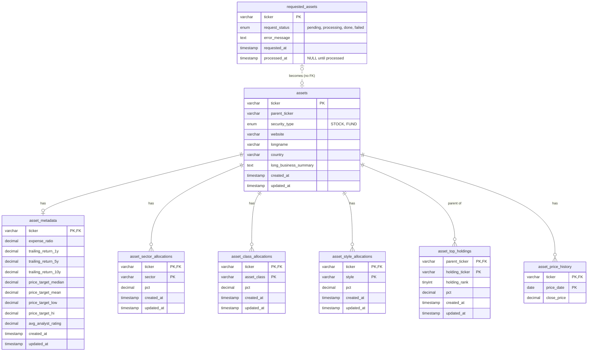

# Mean-Variance Portfolio Optimizer
This tool is deployed at https://portfolioopt-cb.streamlit.app/ and uses Railway to host the MySQL database.

## Overview
This tool is designed to help you choose a set of investments which suit your personal risk profile, and for which the Sharpe Ratio (excess expected portfolio return you can expect relative to the excess volatility it introduces above the '
'risk-free asset) is maximized across the investment options you provide. This tool proceeds in three steps:

1. **Setup**: Choose your candidate assets and set optimization parameters. The candidate assets can be chosen from the current set in the database which will appear in the multi-select below. Be sure to choose assets that represent a wide array of asset types and sectors, otherwise the optimizer will likely not converge. If you don't know where to start, you can just select all of the assets available. If there's a fund you wish was included here, you can add it to the request queue.

2. Run optimization by clicking the button.

3. Optionally, if you want to calculate the number of shares you should buy/own given the size of your current portfolio, you can get these numbers after the optimization completes.

**Important Note**: This is a financial planning tool. Financial planning tools and educational content do not constitute personalized investment, tax, or legal advice. The presence of this application does not imply a certain level of skill or training. The projections, simulations, and outputs shown are best estimates based on the funds, optimization bounds and other inputs you provide. They are not guarantees of future performance. This model relies on historical data and assumed return distributions that may not reflect actual future returns. Past performance is not indicative of future results. Always consult a qualified professional before making material financial decisions.


## Application Architecture


## Database Architecture


## Updating Data
Because Morningstar no longer allows automated pulling (to prevent AI bots from endlessly scraping it) and we need to acquire Morningstar data via a headless browser, it has to be done manually on my local machine and added to a database for posterity. 

Generally speaking, we want all of the stocks and funds to be roughly the same level of freshness, otherwise the optimization may favor those with more recent history in the case of a recent stock market increase (or disfavor those with recent history in the case of a fall). Given this, the whole set of assets that live in the database should be refreshed somewhere between weekly and monthly, or everything should be refreshed if we're clearing a large request queue.

New assets enter through `requested_assets` (`pending` -> `processing` -> `done` or `failed`). `data_collection.py` works through whatever is pending, works out whether each ticker is a stock or a fund, and writes everything to the asset tables. Failed requests keep their error message so they can be retried.

### Run Log
A starting set of 75 assets (a mix of stocks, ETFs and mutual funds) has been successfully pulled as of 10/15/26 around 5pm.

## Optimization Strategy
I'm using Mean-Variance Optimization to develop an efficient portfolio from the desired set of assets, allowing me to take into account expected return, correlation between assets, and accounting for personal risk tolerance (determined by. the optimization parameters).

Rather than choosing a risk aversion coefficient $q$ and minimizing $w^{T}\Sigma w - q R^{T}w$, I solve for the portfolio with the highest Sharpe ratio (return above the risk free rate per unit of risk) using `pypfopt`. The optimization implemented here is as follows: 

$\max \frac{R^{T}w - r_f}{\sqrt{w^{T}\Sigma w}}$ over $w$ where: 
- $w$ = vector of portfolio weights (which will be optimized)
- $\Sigma$ is the covariance matrix of the potential assets where the annualized variance is calculated by using week over week changes in historical closing prices, calculating the variance of those returns and multiplying by 52. A Ledoit-Wolf shrunk estimate of this matrix is used.
- $R$ is the vector of expected (adjusted) returns (expressed as an annualized arithmetic mean)
- $r_f$ is the assumed risk free rate

Max Sharpe means I don't have to know my own numerical risk tolerance, which is hard to pin down. Risk tolerance comes in separately through the cash share, and the optimizer decides what the invested part should look like. 

### Inputs 
Note that all values are calculated over the entire period over which all assets have available history, up to twelve years.
- **Prices:** weekly closes, adjusted for splits and dividends so returns are total returns. Fund prices already reflect their expense ratios. 
- **Expected returns:** the arithmetic mean of weekly returns, times 52. Mean-variance is a single-period model, so the expected return per period is the right input. A compounded (geometric) average would understate it.
- **Covariance:** using weekly returns, annualized, with Ledoit-Wolf shrinkage. With a lot of assets and limited history the plain sample covariance is noisy and gives unstable weights, and shrinkage pulls it towards something steadier. Weekly rather than daily returns are less noisy and reduce the mismatch in closing times between mutual funds, ETFs and foreign markets.
- **Risk free rate:** an assumption I set (sidebar in the app). It's the baseline for the Sharpe ratio and what any cash earns.
- **Look-through holdings:** direct stocks plus the top 10 holdings of each fund, used for the single stock limit. Only the top 10 are stored, so this is a lower bound on true exposure, although likely a very good proxy. 

### Shared history window
Every asset has to be measured over the same dates or the comparison isn't fair. Prices are lined up by week (each weekly bar is dated to its Monday), and only the weeks where **every** selected asset has a price are kept. The window therefore starts when the youngest selected asset starts and ends at the latest price in the database. Some consequences:
- Adding a young fund shortens the history for everything in the optimization.
- The window is recalculated whenever the selection changes, and the app shows which dates it covers in the price history graph below asset selection.
- A warning appears if the shared window is short (the threshold for this warning is set in `config.py`), since the estimates get noisy.
- Assets with no price history at all are dropped.
- Up to 10 years of weekly history is stored per asset, so that's the most any window can cover.

Special note on mini-funds: some funds that are considered "mini-funds" track a fund with more longevity (ie. QQQM relative to QQQ). For some of the most popular mini funds, they were only introduced recently and so including them in calculating this shared history truncates the window for all assets. To get around this, the longer history of the parent fund (which is equivalent) is pulled to calculate relative returns. 

### Constraints
All of these are linear constraints on the weights, and the defaults live in `config.py` (they can be changed in the app's sidebar):
- No single stock accounting for more than 3% of entire portfolio (this will take into account both single stocks and top holdings of ETFs and funds)
- Sum of proportions invested = constant, where constant = 1 - % invested into risk free asset (cash is modeled as a fixed weight asset earning the risk free rate, so every other limit stays a percent of the whole portfolio)
- Asset class (cap size and geography) constraints, each as a range of the whole portfolio:

  | Asset class | Range |
  |---|---|
  | Domestic large cap | 45 - 55% |
  | Domestic mid cap | 10 - 15% |
  | Domestic small cap | 8 - 12% |
  | International large cap | 14 - 16% |
  | International mid cap | 1 - 3% |
  | International small cap | 0 - 2% |
  | Emerging markets | 2 - 5% |
- Sector constraints (each sector of the economy between 1% and 25%)
- Weights all need to be between 0 and 1

Value / growth / blend style is reported for the final portfolio but isn't constrained.

### Outputs
The app shows the Sharpe ratio, expected return and weighted expense ratio, the weights, sector / asset class / style / top holding breakdowns and the efficient frontier. It can also turn the weights into whole share counts for a given portfolio size (greedy allocation from `pypfopt`, using the latest stored weekly close). Note that the Sharpe ratio is in-sample: it's calculated from the same history used to pick the weights, so it describes the past and will flatter what to expect going forward. 

A (relatively crude) backtesting is also performed using the chosen portfolio. This assumes we had adopted the recommended set of investments at the beginning of the shared history window, rebalancing at some set interval (yearly) and paying taxes as necessary around that time. The results of this - performance, cost basis and taxes paid - are also presented as outputs.

### What isn't modeled
I'm ignoring tax constraints (account type, capital gains, dividend treatment, loss harvesting) and transaction fees (commissions, spreads, the cost of rebalancing). Expense ratios are the only costs that show up, and those are already in fund returns. Once again, this isn't financial advice.

## Setup
Everything below runs on a personal machine. You'll need Python (developed on 3.13.7) and MySQL 8 or newer, and `mstarpy` needs whatever headless browser setup its docs call for (Chrome is fine).

1. **Install requirements**
In your cloned repo directory: 
   ```
   python3 -m venv .venv
   source .venv/bin/activate
   pip install -r requirements.txt
   ```
2. **Create the database and tables**
   ```
   mysql -u root -p -e "CREATE DATABASE IF NOT EXISTS portfolio_db CHARACTER SET utf8mb4"
   mysql -u root -p portfolio_db < setup.sql
   ```
3. **Add credentials.** Copy `.env.example` to `.env` and fill in the connection details (never commit `.env`):
   ```
   DB_HOST=127.0.0.1
   DB_PORT=3306
   DB_USER=root
   DB_PASSWORD=your_password
   DB_NAME=portfolio_db
   ```
4. **Queue and collect assets.** Put the tickers you want in `seed_requests.py`, then:
   ```
   python seed_requests.py
   python data_collection.py
   ```
   `data_collection.py` takes `--limit N`, `--retry-failed`, `--reset-stuck` (after a crashed run) and `--requeue-stale DAYS` (refresh old assets). To check on the queue:
   ```sql
   SELECT request_status, COUNT(*) FROM requested_assets GROUP BY request_status;
   SELECT ticker, error_message FROM requested_assets WHERE request_status = 'failed';
   ```
5. **Run the app**
   ```
   streamlit run app.py
   ```
   `python optimization.py` prints the same optimization as a text report without the app.

## Potential Future Work
- **Aligning tickers to a parent ticker:** different tickers for the same underlying thing (share classes like GOOG and GOOGL, or a fund and its twin) are treated as separate assets right now. That means the single stock limit undercounts exposure to a company, and near identical assets can both be picked. Mapping them to one parent ticker would fix both. This is not a trivial problem nor is it exceptionally common.