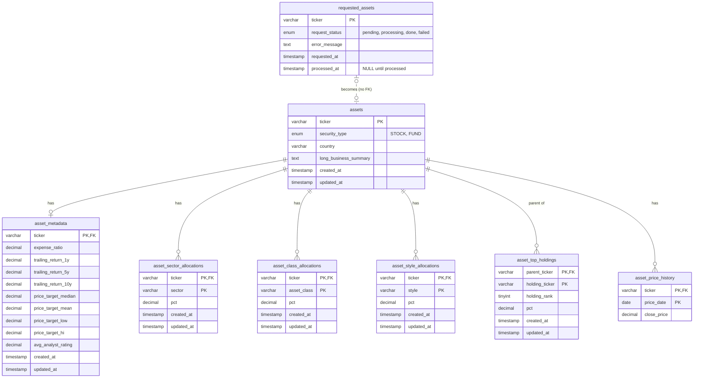

## Application Architecture

## Database Architecture

## Database Updates
Because Morningstar no longer allows automated pulling and we need to acquire Morningstar data via a headless browser, it has to be done manually on my local machine and added to a database for posterity. 

Generally speaking, we want all of the stocks and funds to be roughly the same level of freshness, otherwise the optimization may favor those with more recent history in the case of a recent stock market increase (or disfavor those with recent history in the case of a fall). Given this, the whole set of assets that live in the database should be refreshed somewhere between weekly and monthly, or everything should be refreshed if we're clearing a large request queue.

## Optimization Strategy
I'm using Mean-Variance Optimization to develop an efficient portfolio from the desired set of assets, allowing me to take into account expected return, correlation between assets, and accounting for personal risk coefficient.

The quadratic optimization implemented here is as follows: 
$min w^{T}\Sigma w - q R^{T}w$ over $w$ where: 
- $w$ = vector of portfolio weights (which will be optimized)
- $\Sigma$ is the covariance matrix of the potential assets where the annualized variance is calculated by using week over week changes in historical closing prices, calculating the variance of those returns and multiplying by 52.
- $q$ is the risk aversion coefficient
- $R$ is the vector of expected (adjusted) returns (expressed as an annualized arithmetic mean)

The optimization carries the following linear constraints: 
- No single stock accounting for more than 10% of entire portfolio (this will take into account both single stocks and top holdings of ETFs and funds)
- Sum of proportions invested = constant, where constant = 1 - % invested into risk free asset
- Asset-style (cap, geography, etc) constraints (within 2% of provided or age-based targets)
- Sector constraints (no more than 30% in any given sector of the economy)
- Weights all need to be between 0 and 1

### Run Log
A starting set of 35 assets (a mix of stocks, ETFs and mutual funds) has been successfully pulled as of 10/1/26 around 11am.